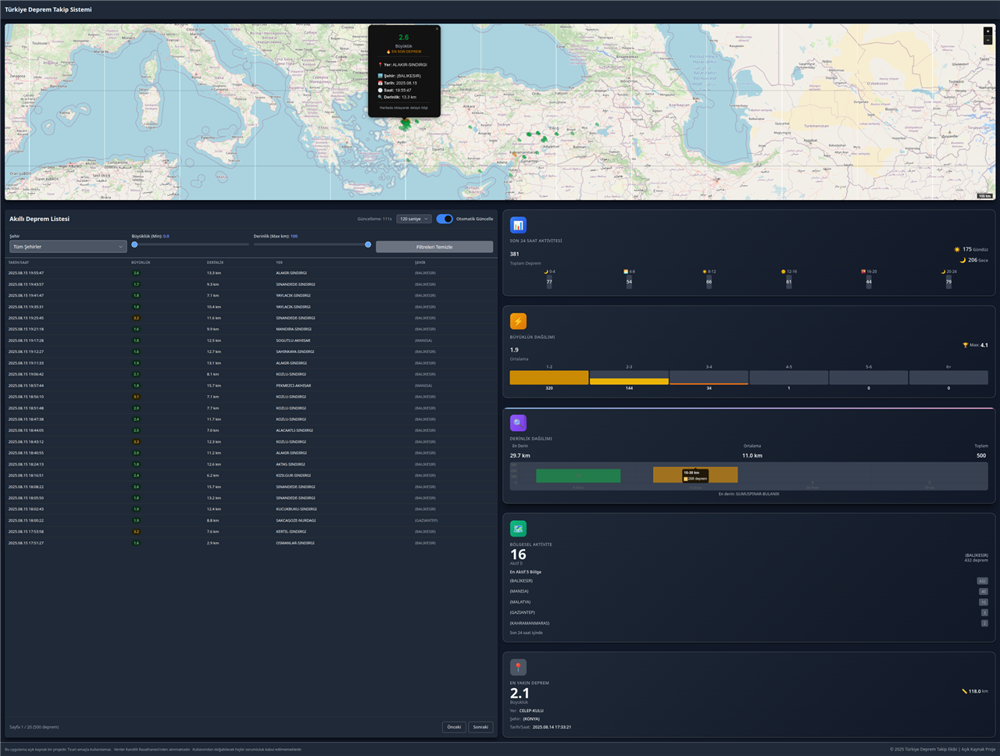

# Sismolog — Türkiye Deprem Takip Sistemi

Kandilli Rasathanesi'nin kamuya açık deprem listesini çekip harita, liste ve istatistik kartlarıyla gösteren küçük bir Node.js/Express uygulaması.

**Canlı:** https://sismolog-fj13lgl4o-cenktekins-projects.vercel.app



## Özellikler

- Son depremler: son 500 kayıt, Leaflet haritasında büyüklüğe göre renkli işaretçiler
- Filtreleme: minimum/maksimum büyüklük, derinlik, şehir + sayfalama (25 kayıt/sayfa)
- İstatistik kartları (Chart.js): son 24 saat, büyüklük dağılımı, derinlik dağılımı, bölgesel aktivite
- 120 saniyelik otomatik yenileme (kapatılabilir, sıklık seçilebilir) + geri sayım göstergesi
- En yakın deprem kartı (tarayıcı konum izni verilirse)
- Koyu tema, mobil/tablet uyumlu düzen
- JSON API: `/api/v1/depremler`

## Teknoloji

| Katman | Kullanılan |
|---|---|
| Sunucu | Node.js ≥18, Express 4 |
| Şablon | EJS |
| CSS | Tailwind CSS 3 (build sırasında derlenir, CDN yok) |
| Harita | Leaflet 1.9 (CDN, SRI ile sabitlenmiş) |
| Grafik | Chart.js 4.4 + chartjs-plugin-datalabels (CDN, SRI ile sabitlenmiş) |
| Güvenlik | helmet + express-rate-limit (API: 60 istek/dakika/IP) |
| Dağıtım | Vercel (tek serverless fonksiyon: `index.js`, statik dosyalar CDN'den) |

## Veri Kaynakları

1. **Kandilli** — `http://www.koeri.boun.edu.tr/scripts/lst0.asp` HTML kazıma, windows-1254 kod çözümü.
2. **AFAD** — `https://deprem.afad.gov.tr/apiv2/event/filter` JSON ucu (yedek, son 72 saat).

Birincil kaynak düştüğünde ikinci kaynak otomatik devreye girer; tüm kaynaklar düşerse API **503** ve görünür hata döner (sessiz boş liste yok). Veriler 2 dakika bellekte önbelleklenir; kaynak düştüğünde bayat önbellek `X-Data-Source: stale` ile sunulur.

## Kurulum

```bash
npm install
npm run build     # public/css/style.css üretilir (Tailwind derlemesi)
npm start         # http://localhost:3000
```

`public/` derleme çıktısıdır ve repoda tutulmaz; bu yüzden `npm start` öncesinde `npm run build` gerekir.
Geliştirme sırasında `npm run dev` (nodemon) kullanılabilir.

### Script'ler

| Komut | Ne yapar |
|---|---|
| `npm start` | Sunucuyu başlatır |
| `npm run build` | Tailwind CSS'i `public/css/style.css` olarak derler |
| `npm run dev` | nodemon ile izleyerek başlatır |
| `npm run check` | Tüm sunucu ve tarayıcı script'lerinde sözdizimi kontrolü |
| `npm test` | `node:test` birim/entegrasyon testleri (ek bağımlılık yok) |

## API

```http
GET /api/v1/depremler
```

| Parametre | Açıklama | Örnek |
|---|---|---|
| `tarih` | Belirli gün (YYYY.AA.GG veya YYYY-AA-GG) | `?tarih=2026.10.27` |
| `min` | Minimum büyüklük | `?min=4.0` |
| `max` | Maksimum büyüklük | `?max=2.5` |
| `sehir` | Şehir (parantez içi il etiketi, harf duyarsız) | `?sehir=YALOVA` |

Yanıt: `tarih, saat, enlem, boylam, derinlik, buyukluk, yer, sehir` alanlarını taşıyan nesne dizisi.

Yanıt başlıkları:

| Başlık | Anlamı |
|---|---|
| `X-Cache-Age` | Önbellekteki verinin yaşı (saniye) |
| `X-Cache-Max-Age` | Önbellek ömrü (saniye) |
| `X-Data-Source` | `kandilli`, `afad`, `cache`, `stale` veya `unavailable` |
| `X-Data-Warning` | Bir kaynak düştüyse hangi kaynak/neden (varsa) |

```bash
curl "https://sismolog-fj13lgl4o-cenktekins-projects.vercel.app/api/v1/depremler?min=4.0"
```

## Mimari

```
index.js              Giriş noktası (sunucu başlatma + Vercel export)
lib/app.js            Express uygulaması: helmet, rate limit, rotalar
lib/sources.js        Kandilli + AFAD çekme, yedekleme, önbellek
lib/parse.js          Saf ayrıştırma/filtre fonksiyonları (test edilebilir)
views/index.ejs       Tek sayfa arayüzü
assets/js/core.js     Paylaşılan durum, DOM yardımcıları, mesafe/en yakın hesabı
assets/js/map.js      Leaflet haritası ve işaretçiler
assets/js/list.js     Liste, filtre, sayfalama
assets/js/refresh.js  Veri çekme, otomatik yenileme, kullanıcı tercihleri
assets/js/app.js      Kabuk: olay bağlama ve başlatma
assets/js/stats.js    İstatistik kartları ve grafikler
assets/css/*.css      Tailwind kaynağı (tailwind.css) + el yazımı stiller
tests/                node:test birim + API entegrasyon testleri
public/               Derleme çıktısı (git'te yok)
archive/              Kullanılmayan eski dosyalar (PHP kalıntıları, ölü API, eski testler)
```

## Bilinen Sınırlar

- Kimlik doğrulama, veritabanı, Socket.IO/gerçek zamanlı itme **yoktur**; yenileme istemci tarafında zamanlayıcıyla yapılır.
- CORS yapılandırması yoktur; API aynı origin'den kullanılır. Rate limit IP başına 60 istek/dakika.
- Leaflet ve Chart.js CDN'den gelir (SRI sabit); çevrimdışı çalışmaz. Harita karoları OpenStreetMap'ten yüklenir.
- Kandilli sayfa yapısı değişirse ayrıştırma kırılır; bu durumda AFAD yedeği devreye girer.
- `sehir` alanı Kandilli'de parantez içi il etiketi, AFAD'da `province` alanıdır. Deniz/il dışı kayıtlarda boş olabilir (~45/500).
- Veriler bilgilendirme amaçlıdır, resmî kaynak yerine geçmez.

## Lisans

MIT — bkz. [LICENSE](LICENSE).

Veriler Boğaziçi Üniversitesi Kandilli Rasathanesi ve Deprem Araştırma Enstitüsü ile AFAD'dan alınmaktadır. Kullanımdan doğabilecek sorumluluk kabul edilmez.
