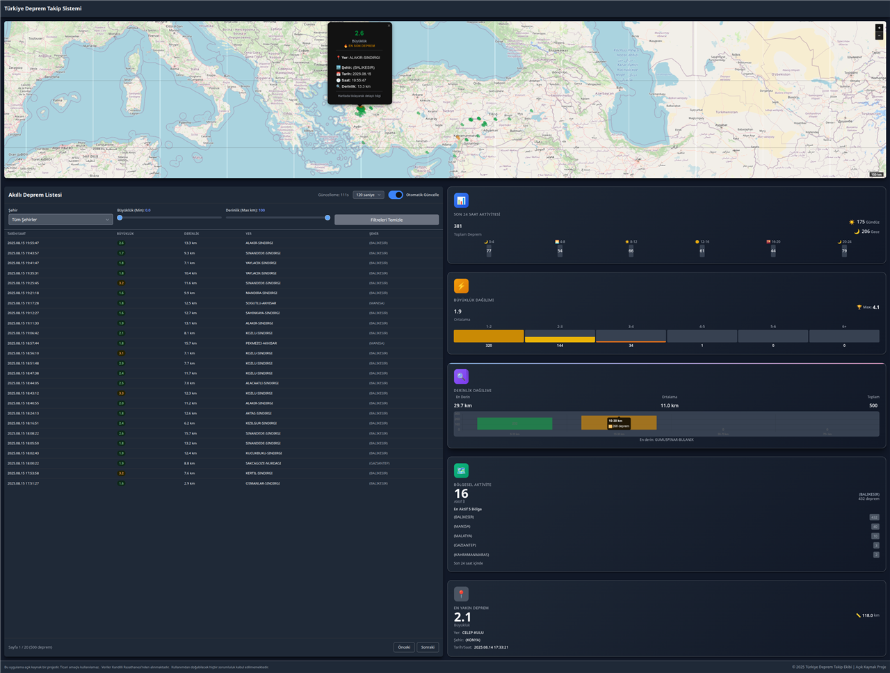

# Sismolog — Türkiye Deprem Takip Sistemi

Kandilli Rasathanesi'nin kamuya açık deprem listesini çekip harita, liste ve istatistik kartlarıyla gösteren küçük bir Node.js/Express uygulaması.

**Canlı:** https://sismolog-fj13lgl4o-cenktekins-projects.vercel.app



## Özellikler

- Son depremler: son 500 kayıt, Leaflet haritasında büyüklüğe göre renkli işaretçiler
- Filtreleme: tarih, minimum/maksimum büyüklük, şehir
- İstatistik kartları (Chart.js): son 24 saat, büyüklük dağılımı, derinlik dağılımı, bölgesel aktivite
- 120 saniyelik otomatik yenileme (kapatılabilir, sıklık seçilebilir) + geri sayım göstergesi
- Koyu tema, mobil/tablet uyumlu düzen
- JSON API: `/api/v1/depremler`

## Teknoloji

| Katman | Kullanılan |
|---|---|
| Sunucu | Node.js ≥18, Express 4 |
| Şablon | EJS |
| CSS | Tailwind CSS 3 (build sırasında derlenir, CDN yok) |
| Harita | Leaflet 1.9 (CDN) |
| Grafik | Chart.js + chartjs-plugin-datalabels (CDN) |
| Dağıtım | Vercel (tek serverless fonksiyon: `index.js`) |

## Veri Kaynağı

Veriler `http://www.koeri.boun.edu.tr/scripts/lst0.asp` adresinden HTML kazıma (scraping) ile alınır, sunucu tarafında ayrıştırılır ve 2 dakika bellekte önbelleklenir.

> ⚠️ Kandilli sayfa yapısını değiştirirse ayrıştırma kırılır. Uygulama bu durumda hata vermek yerine son önbellekteki veriyi, o da yoksa boş listeyi döndürür.

## Kurulum

```bash
npm install
npm run build     # public/css/style.css üretilir (Tailwind derlemesi)
npm start         # http://localhost:3000
```

`public/` derleme çıktısıdır ve repoda tutulmaz; bu yüzden `npm start` öncesinde `npm run build` gerekir.
Geliştirme sırasında `npm run dev` (nodemon) kullanılabilir.

### Script'ler

| Komut | Ne yapar |
|---|---|
| `npm start` | Sunucuyu başlatır |
| `npm run build` | Tailwind CSS'i `public/css/style.css` olarak derler |
| `npm run dev` | nodemon ile izleyerek başlatır |
| `npm run check` | `index.js` + tarayıcı script'lerinde sözdizimi kontrolü |

## API

```http
GET /api/v1/depremler
```

| Parametre | Açıklama | Örnek |
|---|---|---|
| `tarih` | Belirli gün (YYYY.AA.GG) | `?tarih=2026.10.27` |
| `min` | Minimum büyüklük | `?min=4.0` |
| `max` | Maksimum büyüklük | `?max=2.5` |
| `sehir` | Şehir (parantezli etiket) | `?sehir=(YALOVA)` |

Yanıt: `tarih, saat, enlem, boylam, derinlik, buyukluk, yer, sehir` alanlarını taşıyan nesne dizisi.
Yanıt başlıkları: `X-Cache-Age`, `X-Cache-Max-Age`, `X-Data-Source`.

```bash
curl "https://sismolog-fj13lgl4o-cenktekins-projects.vercel.app/api/v1/depremler?min=4.0"
```

## Mimari

```
index.js              Express uygulaması: veri çekme/ayrıştırma, önbellek, 2 rota
views/index.ejs       Tek sayfa arayüzü
assets/js/app.js      Liste, harita, filtreler, otomatik yenileme
assets/js/stats.js    İstatistik kartları ve grafikler
assets/css/*.css      Tailwind kaynağı (tailwind.css) + el yazımı stiller
public/               Derleme çıktısı (git'te yok)
archive/              Kullanılmayan eski dosyalar (PHP kalıntıları, ölü API, eski testler)
```

## Bilinen Sınırlar

- Kimlik doğrulama, veritabanı, Socket.IO/gerçek zamanlı itme **yoktur**; yenileme istemci tarafında zamanlayıcıyla yapılır.
- Otomatik test yoktur. `archive/2026-10-27-legacy/tests/` altındaki eski testler gerçek kodu import etmediği için devre dışı bırakıldı.
- Tek veri kaynağı (Kandilli) — ikinci kaynak/AFAD yedeği yoktur.
- Sunucu tarafı güvenlik başlıkları (Helmet), rate limiting ve CORS yapılandırması **yoktur**; yalnızca `express.json`/`express.urlencoded` ve statik dosya sunumu vardır.
- Veriler bilgilendirme amaçlıdır, resmî kaynak yerine geçmez.

## Lisans

MIT — bkz. [LICENSE](LICENSE).

Veriler Boğaziçi Üniversitesi Kandilli Rasathanesi ve Deprem Araştırma Enstitüsü'nden alınmaktadır. Kullanımdan doğabilecek sorumluluk kabul edilmez.
